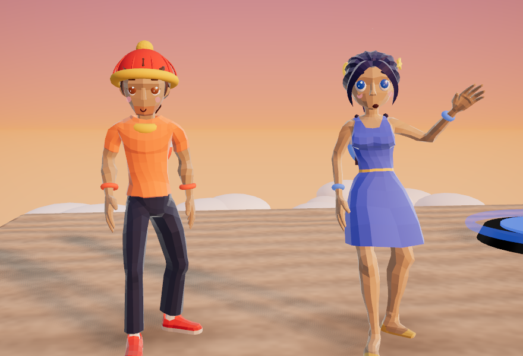
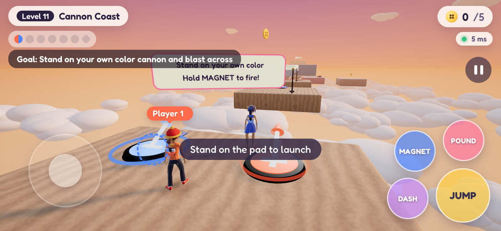

# It Takes Two

**A two-player co-op 3D platformer that runs in the browser.** One computer runs a tiny
server; you and a friend join from any two devices on the same Wi-Fi: laptops, desktops
or phones. Every level is designed by hand, and almost everything needs both of you.



- **Campaign:** 30 levels, each built around its own idea. Magnets, seesaws, beat blocks,
  conveyor belts, fans, hammers, cannons, invisible roads, ice, low gravity, rising lava,
  portals, a rope that ties you together, a runaway train, tides, a map maze and a dance floor.
- **Escape Rooms:** 10 puzzle rooms where one of you finds the clue and the other works
  the machine.
- **Horror:** six connected nights with one story, rules to obey, notes to read, places to
  hide and something that hunts you. Scary, no gore.
- **Prank Park:** an obstacle course full of trick blocks. One of you stands on an eye plate
  to see the tricks and calls them out.



## Play

You need [Node.js](https://nodejs.org) 18 or newer.

```sh
git clone <this repository>
cd <the folder>
npm install
npm start
```

The server prints two addresses:

- **You:** `http://localhost:3000`
- **Partner:** `http://192.168.x.x:3000` (open this on the second device, on the same Wi-Fi)

Both players press **Ready** and the level starts. On macOS, allow incoming connections for
Node if the firewall asks, or your partner won't be able to connect. On Windows, allow Node
through the firewall on private networks.

To try it alone, open the address in two browser windows on one computer.

One server hosts one game for two players. If both seats are taken by two tabs on the same
device, a second device that opens the page takes over one of them.

### On a phone or tablet

Open the partner address in the browser and turn the device sideways. On-screen controls
appear while playing:

- Drag your left thumb to move, and swipe on the right side to turn the camera.
- **JUMP**, **DASH**, **POUND** and **MAGNET** (hold it) do the actions.
- **❚❚** pauses.

On iPhone, tap Share → **Add to Home Screen** and play from that icon for full screen.

## Controls

| Action | Keyboard / mouse | Gamepad |
| --- | --- | --- |
| Move | WASD | Left stick |
| Camera | Mouse (click the game to capture it), scroll to zoom | Right stick |
| Jump / double jump | Space | A |
| Dash | Shift | X |
| Ground pound (in the air, or standing: hop + pound) | C | B |
| Magnet | E or left click (hold) | RB |
| Wave | G | D-pad up |
| Reread notes (horror) | J | |
| Menu | Esc | Start |

Browsers only allow gamepads on secure pages, so on the partner's device (plain `http://`
over the LAN) a gamepad may not work. Keyboard, mouse and touch always do.

## The heroes

**Sol** (red) and **Luna** (blue) each carry a horseshoe magnet on their back.

- **Opposites attract:** hold the magnet button to fly to a pad of the other color and hang
  from it.
- **Same color repels:** stand on a pad of your own color and hold the magnet to launch.
- **Partner bond:** whoever is across holds the magnet first ("calling"); then the other
  holds it to fly over.

Their backpacks and wristbands glow while the magnet is on. They wave (G), carry things
overhead and react to what's happening: their eyes blink, and their faces change when they
jump, fall, pound or get spooked.

## Modes

Pick a mode with the tabs in the lobby. Each mode keeps its own save, and every mode is a
chain: finishing a level counts down and goes straight on to the next (or press
**Back to lobby** to stop). You can also pick any level from the lobby.

### Campaign

| # | Level | What it's about |
| --- | --- | --- |
| 1 | First Steps | run, jump, double jump, dash, pound, plates for two |
| 2 | Magnet Pals | magnet lanes, launch pads, calling your partner across |
| 3 | Seesaw Park | one pounds, one flies: seesaws of every kind |
| 4 | Pressure Plates | plate logic: leapfrog bridges, crossed stairs, an airlock |
| 5 | Beat Blocks | blocks that come and go to a beat; your partner swaps red/blue |
| 6 | Crumbling Path | paths that fall away; one runs ahead laying planks for the other |
| 7 | Conveyor Factory | conveyor belts your partner can reverse |
| 8 | Windy Valley | fans that only blow while your partner stands on a plate |
| 9 | Hammer Hall | swinging hammers to dodge or stop |
| 10 | Ride Along | one rides a platform, the other drives it |
| 11 | Cannon Coast | magnet cannons and mid-air partner bonds |
| 12 | Sprint Gates | timed switches: one presses, one sprints |
| 13 | Invisible Road | only the one on the eye plate sees the real path |
| 14 | Spin World | gears, clock hands, a turning bridge you stop when it lines up |
| 15 | Bounce Castle | bounce drums; pound for height |
| 16 | Piston Workshop | pistons that punch, lift and form a lights-out bridge |
| 17 | Ice Slide | ice: no stopping; slide into stoppers |
| 18 | Moon Walk | low gravity that switches on and off |
| 19 | Rising Lava | rising lava; one holds it back while the other climbs |
| 20 | Red & Blue | red/blue blocks swapped by your partner, even mid-jump |
| 21 | Portal Maze | portals, portals for two, a maze of rooms joined by portals |
| 22 | Special Delivery | parcels only one of you can carry, relayed across obstacles |
| 23 | Night Run | darkness; glass that's only solid in a flashlight beam |
| 24 | Mirror Lanes | two lanes: your plates move your partner's lane |
| 25 | Rope Buddies | tied together by a rope |
| 26 | Runaway Train | jumping car to car; the signal box picks the train |
| 27 | Tide Pool | water that rises and falls; rafts and valves |
| 28 | Map Maze | one reads the map from above, the other walks the maze |
| 29 | Memory Dance | remember the order of the lights; each of you sees half |
| 30 | Grand Finale | everything at once |

Golden buttons are optional collectibles (stars on the complete screen). Checkpoints sit
between stages.

### Escape Rooms

Toy Vault · Clock Shop · Magic Library · Candy Factory · Pirate Ship · Pyramid ·
Space Station · Detective Agency · Ice Castle · Machine City.

Split up and solve them together: one of you sees the clue, the other acts on it. There are
items only one of you can carry; number, color, arrow and symbol wheels; order codes;
lights-out puzzles; and launches, seesaws, fans and lifts. Each room is longer than the one
before.

### Horror

Six nights, one story: Midnight School Rules · Dorm 404 · The Last Train · Mercy Hospital ·
The Paper Doll Mansion · Midnight Funfair. Between nights, text messages from an unknown
number tie it together, and the last night reveals who sent them.

The monsters play fair:

- They only walk where there is floor. Across a gap they take the same plank you did, and
  they're slow on anything narrow.
- **Safe rooms** (glowing green floor) make them give up and walk back.
- **Flashlights** freeze them while the beam is on them. Some freeze whenever anyone looks
  at them instead.
- Each chase has a start and an end. A monster only hunts its own area, gives up after a
  while, and leaves you alone for a bit after it catches someone.
- Lockers, wardrobes, beds and booths hide you. Getting caught is a scare and a trip back
  to the checkpoint, and you keep what you were carrying.

## Saving

Progress saves automatically on the server in `saves/progress.json`: the level, each
character's checkpoint, collected buttons and solved puzzles. After restarting the server,
the lobby shows your saved game and **Ready** becomes **Continue!**. **Restart level** in
the pause menu restarts the current level from its first checkpoint.

## How it works

- `server.js` serves the game and runs the room: the lobby, puzzle state (plates, switches,
  dials, items, locks, floods), checkpoints, collectibles and the monsters
  (`public/shared/monster.js`). It relays each player's movement to the other.
- Each browser simulates its own character and draws the partner from interpolated
  snapshots. Moving platforms run on the server's clock, so both screens agree.
- Levels are written with `LevelBuilder` (`public/shared/build.js`): keys and locks, dials
  and combos, prank traps, zones (trigger, kill, hide, safe, red light, warp, low gravity,
  rope), floods, swap blocks, lights, notes and monsters. `public/shared/levels.js` lists
  the modes; the levels live in `public/shared/campaign/`, `escape/`, `stories/` and
  `courses.js`. Gap and ledge sizes come from the jump physics in
  `public/shared/constants.js`.
- The characters (`public/src/character-model.js`) are rigged models whose clips drive
  walking and running. Jumps, falls, flips, landings and pounds blend single frames taken
  from those clips, and the arms are aimed at magnets, the partner or a carried item.
  Hats, faces, backpacks and the rest are built in code.
- Everything else is made in code: level geometry, textures, sound effects and music.

## Tests

```sh
npm test          # every designed level builds and can be solved, monster rules, physics, saving
npm run test:e2e  # two real Chrome players: smoke test + co-op flow
node test/play.mjs [mode[:index] ...]   # bots play levels start to finish with the real controls
```

`test/play.mjs` runs two bot players in headless Chrome through each level's walkthrough
(`test/walkthroughs/<mode>-<key>.mjs`). The bots don't teleport; they use the stick, jump,
pound, magnet and camera, so a pass means the level can really be finished. Add
`--shots DIR` for screenshots and `--chain` to follow the auto-continue into the next level.

The browser tests use the installed Google Chrome; set `CHROME=/path/to/chrome` if it
lives elsewhere.

## Credits

- Character models: "Casual Character" and "Animated Woman" by
  [Quaternius](https://quaternius.com), CC0 (see `public/assets/characters/CREDITS.md`).
- [three.js](https://threejs.org) (MIT) for 3D, [ws](https://github.com/websockets/ws)
  (MIT) for networking, and the [Fredoka](https://fonts.google.com/specimen/Fredoka) font
  (SIL Open Font License).

## License

MIT, see [LICENSE](LICENSE).
